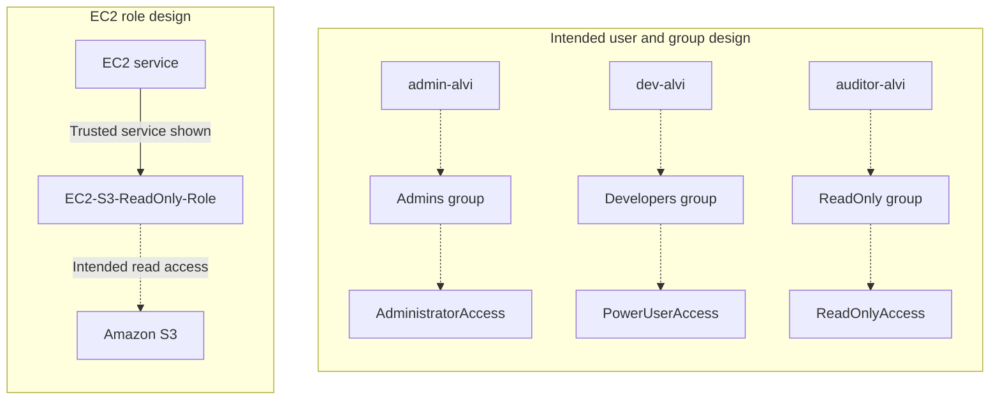
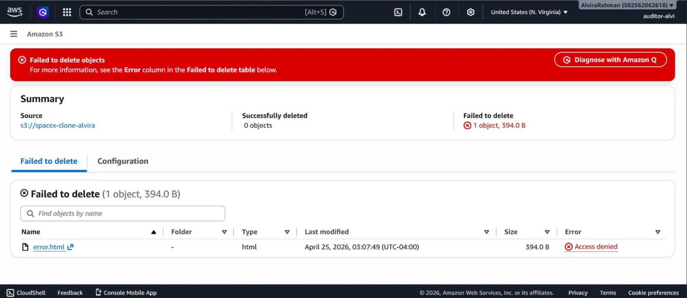
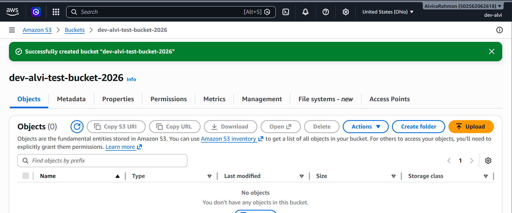

# AWS IAM Security Lab: Identity and Permission Testing

**Alvira Rahman | AWS IAM, Amazon S3, Access Testing, Security Documentation**

I created IAM users and groups, created an EC2-trusted role, and tested selected S3 and IAM actions using auditor and developer identities. I documented both successful actions and expected access denials, together with a deletion incident that demonstrated why session identity matters during permission testing.

This is my second AWS project, supported by 14 screenshots and a detailed troubleshooting case study.

## Start Here

- [Troubleshooting case study](docs/TROUBLESHOOTING.md) — investigation, permission-test results, two Mermaid diagrams, and evidence limits.
- [Screenshot evidence](screenshots/) — all 14 images from the original repository and supporting case-study package.

## What I Configured

- Three IAM groups: `Admins`, `Developers`, and `ReadOnly`.
- Three IAM users: `admin-alvi`, `dev-alvi`, and `auditor-alvi`.
- A role named `EC2-S3-ReadOnly-Role`, with EC2 shown as its trusted service.
- Selected permission tests involving S3 bucket listing, object deletion, bucket creation, and IAM actions.
- A review of the root-account baseline and IAM user MFA indicators.

## Intended Architecture

Dashed links show the intended group and policy relationships recorded in my lab notes. The screenshots do not show every policy attachment. The role capture confirms its creation and EC2 trusted service; runtime use from an EC2 instance is outside the captured evidence.

## Permission-Test Results

| Identity | Test | Expected | Captured result |
|---|---|---|---|
| auditor-alvi | [List website-bucket objects](screenshots/04-auditor-view-s3.png) | Allow | Object list displayed |
| auditor-alvi | [Delete error.html](screenshots/05-auditor-access-denied-delete.png) | Deny | Access denied; zero deletions succeeded |
| auditor-alvi | [Create IAM user Broli](screenshots/06-auditor-cannot-create-user.png) | Deny | iam:CreateUser denied |
| dev-alvi | [Create an S3 bucket](screenshots/07-dev-created-s3-bucket.png) | Allow | Bucket creation succeeded |
| dev-alvi | [Request IAM dashboard information](screenshots/08-dev-cannot-access-iam.png) | Deny for the tested actions | Three named IAM actions denied |

The developer dashboard capture identifies `iam:GetAccountSummary`, `iam:ListMFADevices`, and `iam:ListAccountAliases` as denied. It does not establish that every IAM action was unavailable.

## Selected Evidence

**Expected denial: auditor object deletion**

**Expected allowance: developer bucket creation**

## Troubleshooting Lesson

During the lab, 15 objects totaling 4.0 MB were deleted from the website bucket used in my first AWS project. The original notes identify the active identity as root. Later evidence shows the auditor user being denied an object-deletion operation.

The lesson was to confirm the signed-in identity before interpreting a permission test and to keep test resources separate from another project's website. The supplied records do not document a restoration procedure or a successful post-deletion website check.

[Read the complete incident and permission-testing case study](docs/TROUBLESHOOTING.md).

## Skills Demonstrated

IAM user and group administration; role trust configuration; selected S3 and IAM permission tests; interpretation of access-denied messages; MFA-status review; incident analysis; technical documentation supported by screenshots.

## Planned Improvements

- Enable and verify MFA for the IAM users.
- Document policy attachments and refine resource-scoped permissions.
- Validate the EC2 role through a controlled runtime test.
- Use dedicated test resources and document a versioning/recovery test.

These are planned improvements, not completed changes.

## Scope

The evidence covers IAM setup and selected console permission tests. It does not establish complete policy attachments, a configured IAM permissions boundary, minimum possible permissions, runtime EC2-to-S3 access, or website recovery.

## Repository Contents

| Path | Contents |
|---|---|
| `README.md` | Project overview, intended architecture, and test results |
| `docs/TROUBLESHOOTING.md` | Complete troubleshooting case study |
| `screenshots/` | All 14 screenshots and accompanying evidence documentation |

## Related Project

[Project 1: S3 and CloudFront Website Deployment](https://github.com/Alvira-Rahman/spacex-clone-aws) — the website bucket referenced in the deletion incident.
