# Troubleshooting Case Study 2: AWS IAM Security Lab

**Author:** Alvira Rahman  
**Services:** AWS IAM and Amazon S3; EC2 role trust configuration  
**Lab records:** April 2026  
**Region context:** IAM is global; S3 captures show Northern Virginia and Ohio.

[Project overview](../README.md) | [Screenshot folder](../screenshots/)

## 1. Summary

I created IAM users, groups, and an EC2-trusted role, then tested selected allowed and denied actions using the auditor and developer identities. The lab also exposed a testing-method problem: a deletion performed in the wrong session affected the S3 website from my first AWS project.

| Item | Recorded result |
|---|---|
| Goal | Configure IAM identities and test intended access. |
| Setup | Three user groups, three users, and a custom EC2-trusted role are shown. |
| Auditor tests | S3 objects could be listed; object deletion and IAM user creation were denied. |
| Developer tests | S3 bucket creation succeeded; specific IAM dashboard actions were denied. |
| Deletion incident | S3 reported 15 objects, totaling 4.0 MB, deleted from the website bucket. |
| Recovery status | The available records do not document the restoration procedure or a post-deletion availability test. |

These results demonstrate selected permission checks. They do not establish that an IAM permissions boundary was configured or that every policy was reduced to the minimum necessary permissions.

## 2. Intended Access Model

The original lab notes describe the following group and managed-policy design. The screenshots show the identities and groups, but do not display all policy attachments or the complete policy documents.

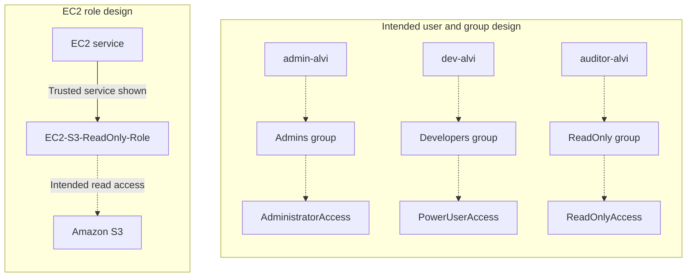

Dashed links represent the intended relationships from the lab notes. The solid role link represents the EC2 trusted service visible in the role-creation screenshot.

| Principal | Intended group or relationship | Policy or purpose recorded in the notes |
|---|---|---|
| admin-alvi | Admins | AdministratorAccess |
| dev-alvi | Developers | PowerUserAccess |
| auditor-alvi | ReadOnly | ReadOnlyAccess |
| EC2-S3-ReadOnly-Role | EC2-trusted role | Intended S3 read access |

### Setup Evidence

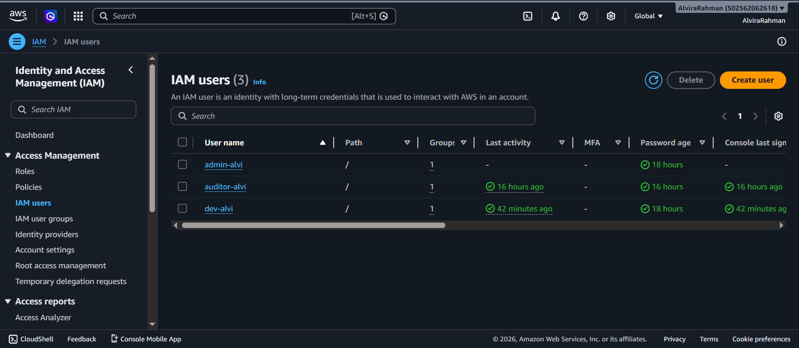

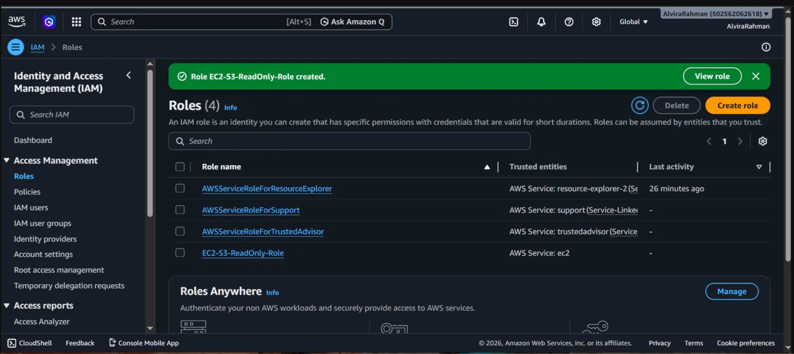

The user-list capture shows one group membership for each user, but does not identify the group names there. The role capture establishes creation and its EC2 trusted service; it does not demonstrate attachment to an instance, role assumption, or an S3 read from EC2.

## 3. Baseline IAM State

The baseline dashboard shows zero IAM users, zero user groups, and three roles. Its security recommendations show that the root user had MFA and no active access keys at the time of capture.

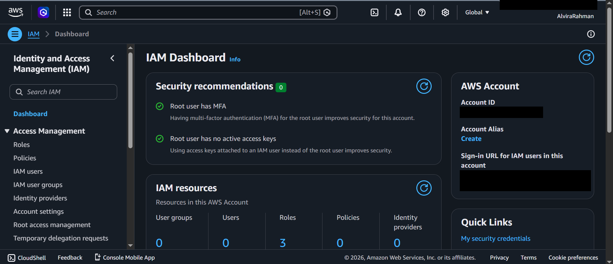

This is an IAM baseline, not evidence that the entire AWS account contained no other resources.

## 4. Incident 1: Website Objects Deleted During Permission Testing

### Phase 1: Detect

A deletion intended to be restricted during permission testing succeeded against `spacex-clone-alvira`, the website bucket used in Project 1.

The original notes identify the active identity as the account root user. The captures show the account-name session label rather than the auditor or developer user names seen in later tests. No matching CloudTrail event is included.

### Phase 2: Investigate

| Check | Finding |
|---|---|
| Target resource | The operation targeted Project 1's website bucket. |
| Selected content | Five top-level entries included folders containing additional objects. |
| Confirmation | The console requested confirmation for permanent deletion. |
| Result | 15 objects, totaling 4.0 MB, deleted; zero failures. |
| Test identity | Recorded as root in the original notes. |
| Policy evidence | The captures do not show every group membership or attached policy. |

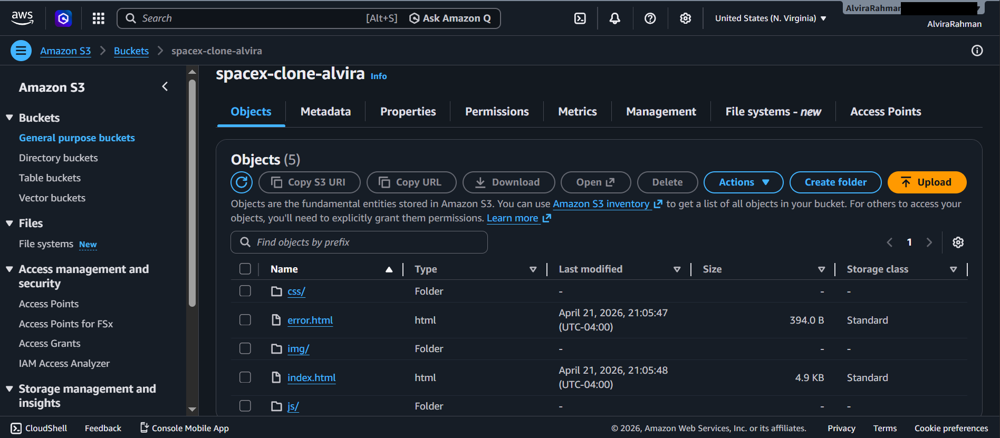

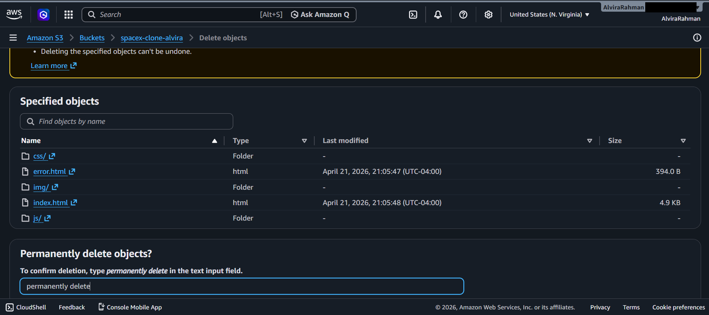

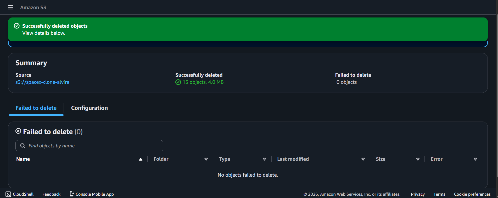

The visible object modification timestamps are not the timestamps of the deletion itself. The available captures do not support an exact minute-by-minute incident timeline.

### Phase 3: Diagnosis

The intended IAM identity's restrictions were not being tested when the action was performed from a separate root session. Policies attached to an IAM user or role do not govern that root session. Root is not exempt from every AWS access control.

The successful deletion therefore did not establish that the auditor's permissions were incorrectly configured.

### Phase 4: Recorded Correction

The notes record switching to IAM user sessions and repeating permission tests. A later capture shows `auditor-alvi` receiving Access denied when attempting to delete `error.html` from the same bucket.

The supplied records do not document a restoration procedure or confirm website availability after deletion.

### Phase 5: Verify

The later auditor test shows zero successful deletions and one failed deletion. That validates the captured auditor operation, rather than proving every aspect of the policy design.

### Lessons

- Confirm the intended identity before testing its permissions.
- Use dedicated test resources so one lab does not affect another project.
- Keep source copies and test a recovery method before relying on it.

## 5. Incident 2: Keeping Permission Tests Tied to the Correct Identity

### Testing Problem

Switching between administrative, auditor, and developer sessions created a risk of testing as the wrong identity. The useful evidence is the combination of the visible session identity, action attempted, and returned result.

### Validation Results

| User | Action tested | Intended result | Captured result | Evidence |
|---|---|---|---|---|
| auditor-alvi | List objects in the website bucket | Allowed | Object list displayed | 04 |
| auditor-alvi | Delete error.html | Denied | Access denied; zero deletions succeeded | 05 |
| auditor-alvi | Create IAM user Broli | Denied | iam:CreateUser denied | 06 |
| dev-alvi | Create an S3 bucket | Allowed | Bucket creation succeeded | 07 |
| dev-alvi | Request IAM dashboard information | Denied for the tested actions | Three named IAM actions denied | 08 |

### Auditor Evidence

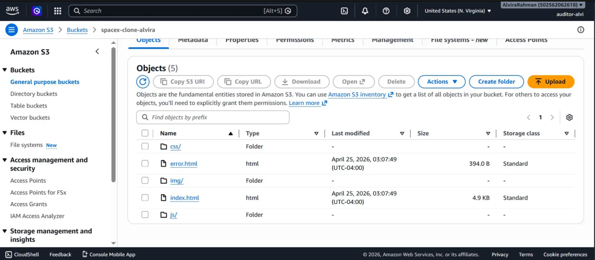

This shows bucket listing in the captured console session, rather than a separate object-download or content-read test.

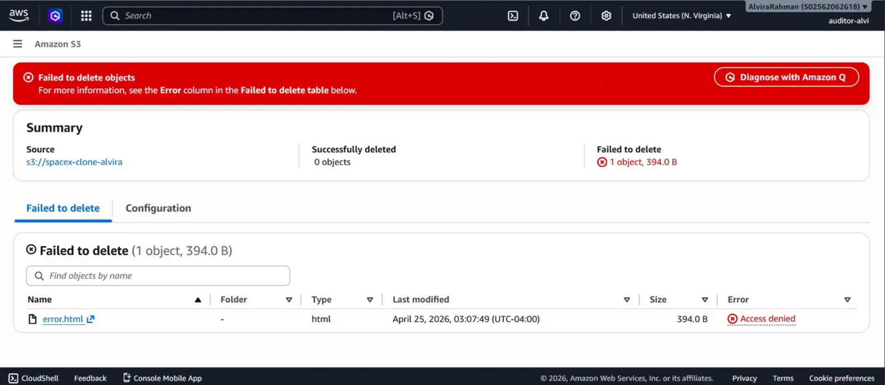

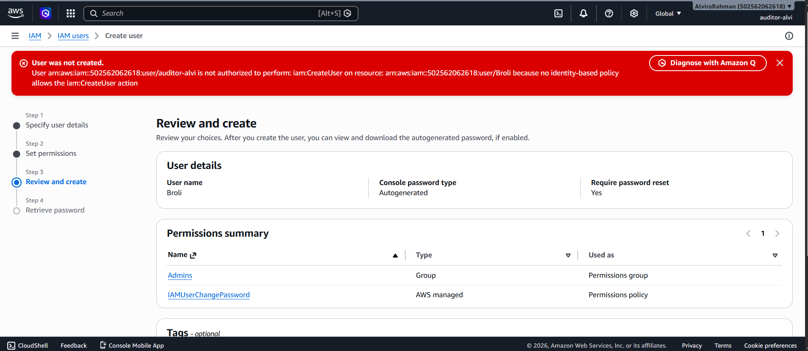

The failed request attempted to create `Broli` with membership in `Admins`. The screenshot below records the proposed configuration before the denied creation attempt; it is not evidence of a successfully created administrative user.

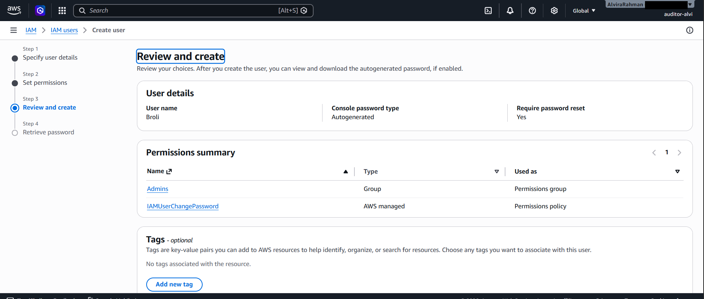

### Developer Evidence

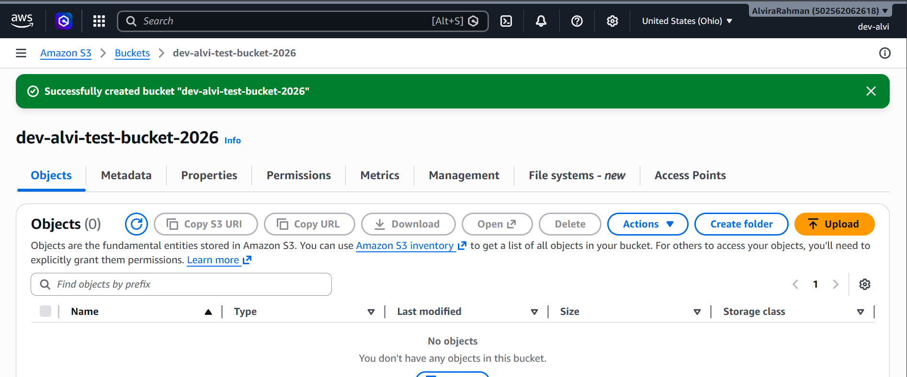

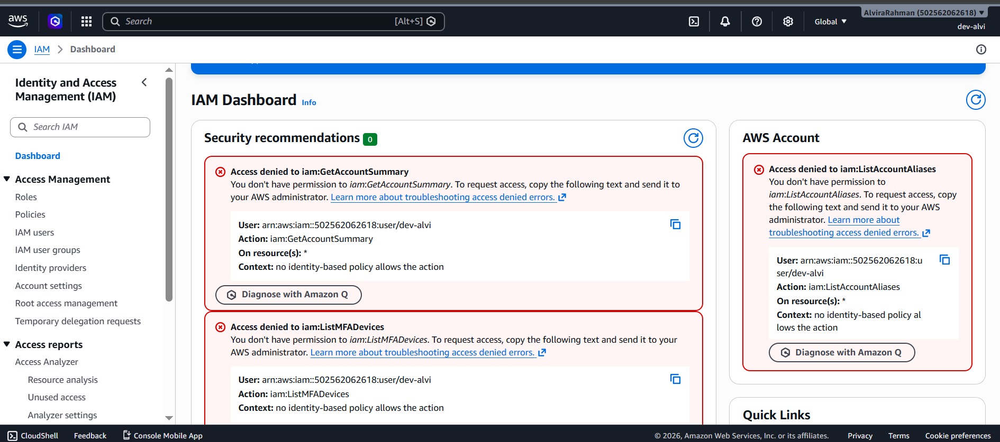

The dashboard capture identifies `iam:GetAccountSummary`, `iam:ListMFADevices`, and `iam:ListAccountAliases` as denied. It does not prove that every IAM action was unavailable.

For the IAM user-creation and dashboard errors, the console reports that no identity-based policy allows the action. An Access denied outcome does not, by itself, prove the presence of an explicit Deny statement.

### Session Handling

The original notes describe using private browsing for tests. In Chrome, opening additional Incognito windows continues the same Incognito session; separate windows alone do not isolate each login.

For repeatable future tests, I would use separate browser profiles, or test one identity at a time and close all Incognito windows before starting a fresh session. The existing captures show the named identities used for the recorded tests, but do not establish how browser sessions were isolated.

A repeatable test record should include:

1. Intended identity and visible signed-in identity.
2. Action and target resource.
3. Expected allow or deny result.
4. Actual result and exact error where available.
5. Supporting capture from that session.

## 6. Troubleshooting Flow

This workflow applies to tests of an intended IAM user or role. A real action performed from the wrong identity can have consequences even though it is not a valid test of the intended identity's permissions.

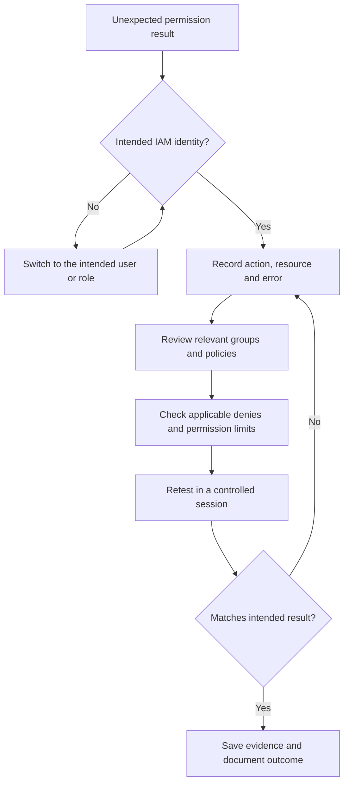

Review both identity-based and relevant resource-based policies. If applicable, also consider permissions boundaries, session policies, and organization controls. These are investigation checks, not claims that every control was configured in this lab.

## 7. Hardening Follow-Ups

The IAM user-list capture shows a dash in the MFA column for all three users.

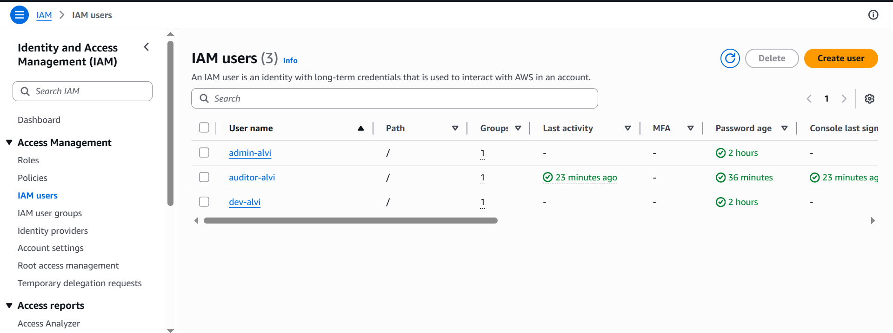

| Area | Evidence or current documentation | Follow-up |
|---|---|---|
| Root MFA | Enabled in the baseline capture | Maintain protection and verify its current state. |
| Root access keys | None active in the baseline capture | Continue avoiding root access keys. |
| IAM user MFA | No MFA indicated in the user-list capture | Enable MFA and validate sign-in behavior. |
| Policy scope | Broad managed policies described in the notes | Document attachments and refine resource-scoped permissions. |
| Test isolation | Website resources were involved in testing | Use dedicated test resources and the intended identity. |
| Recovery | Restoration procedure not documented | Review versioning and perform a controlled recovery test. |
| Audit evidence | No deletion event supplied | Retain CloudTrail records for future tests; review historical records if available. |

These follow-ups are not presented as completed changes. Enabling versioning later does not recreate data already deleted.

## 8. Skills Demonstrated

- Creating IAM users, groups, and an EC2-trusted role.
- Comparing intended access with specific observed results.
- Interpreting IAM access-denied messages.
- Recognizing the effect of session identity on a permission test.
- Identifying MFA, policy-scope, and recovery improvements.
- Documenting incidents and evidence from multiple related projects.

## 9. Scope and Evidence Limits

The case study uses all 14 screenshots: eight from the original repository and six from the supporting package.

The demonstrated work covers IAM setup and selected console permission tests. It does not establish:

- Complete managed-policy attachments or minimum possible permissions.
- A configured IAM permissions boundary.
- Runtime EC2 role assumption or S3 access from an EC2 instance.
- Exact deletion timestamps or a verified website restoration.
- Current account security settings beyond the historical captures.

## 10. References

- [AWS IAM policies and the root user](https://docs.aws.amazon.com/IAM/latest/UserGuide/access_policies.html)
- [AWS policy evaluation logic](https://docs.aws.amazon.com/IAM/latest/UserGuide/reference_policies_evaluation-logic.html)
- [Chrome Incognito sessions](https://support.google.com/chrome/answer/95464)
- [Chrome profiles](https://support.google.com/chrome/answer/2364824)